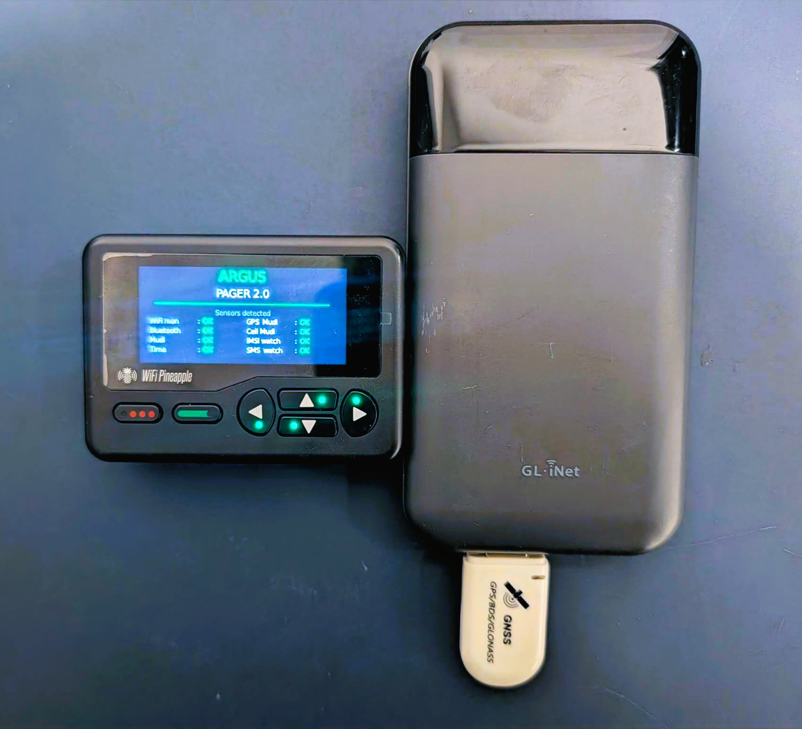

# argus-pager 3.0

**Counter-Surveillance auf dem WiFi Pineapple Pager.** Ein Tool das passiv und mobil
die Frage beantwortet: *"Wer überwacht mich gerade — und wie?"*

> **Neu in 3.0** (2026-11-01)
> - **Mudi 7 (GL-E5800)** wird zusätzlich zum Mudi V2 (GL-E750V2) unterstützt — automatische Hardware-Erkennung, modell-spezifische AT-Pfade und GPS-Backends.
> - Auswertung der Scan-Daten via Desktop-App [**argus-analyst**](https://github.com/tschakram/argus-analyst) (Claude-API, GPS-Karten, BT-Zeitleisten).
> - Codebasis: Fork von argus-pager 2.0 (`origin/main` HEAD `3eaf126`), Rebrand als 3.0.0-alpha0.

<p align="center">
  
  <br>
  <em>Hardware-Stack: WiFi Pineapple Pager (links, mit Argus-Splash) + GL-iNet Mudi — V2 (GL-E750V2) oder Mudi 7 (GL-E5800) — als LTE/GPS-Bridge mit u-blox GNSS-USB-Dongle</em>
</p>

<p align="center">
  
  &nbsp;
  
</p>
<p align="center">
  
  &nbsp;
  
</p>

---

## Was kann das Ding

argus-pager 3.0 vereint vier Quellen auf einem Hardware-Stack
(Pineapple Pager + GL-iNet Mudi V2 **oder** Mudi 7):

- **WiFi / Bluetooth** — wer pingt mich an, wer folgt mir
- **Cellular / GSM-Layer** — bin ich gerade an einem IMSI-Catcher
- **Aktive Funkangriffe** — werde ich gerade vom Netz geworfen
- **Externe Intel** — InternetDB / Shodan / Fingerbank / OpenCelliD

| Bedrohung | Detektor | Quelle |
|---|---|---|
| Apple AirTag, Samsung SmartTag, Tile, Chipolo | BT-Tracker | BLE-Adv |
| Stalker via persistenter Probe-MAC ueber mehrere Sessions | Cross-Report | WiFi-Probe |
| WiFi/BT-Pairing eines mobilen Verfolgers | Pairing-DB | WiFi+BT |
| **Deauth-Flood-Angriff aktiv** | Deauth-Watcher | 802.11 mgmt |
| IP-Kamera / NVR / IoT-Device im Hotelzimmer | Fingerbank-Lookup | DHCP, MAC |
| Aktive Spy-Cam (Bandbreiten-Spike) | Camera-Activity | PCAP |
| **IMSI-Catcher / Stingray** (RAT-Downgrade, TA-Anomalie) | IMSI-Monitor | AT+QENG |
| **IMSI-Catcher** (0 Neighbours, Power-Boost, PCID-Drift) | Cell-Anomaly | AT+QENG=neighbourcell |
| **Silent-SMS / Stille SMS** (Standortpeilung) | SMS-Watch | AT+CMGL |
| Cell-Tower Spoofing (Cell-ID-Mismatch / nicht in DB) | OpenCelliD-Lookup | API |
| Public-IP mit bekannter CVE / verdächtigen Ports | InternetDB / Shodan | API |

---

## Vorgänger-Versionen

argus-pager 3.0 baut auf [**argus-pager 2.0**](https://github.com/tschakram/argus-pager-2.0) auf — dort findest du den detaillierten Feature-Vergleich 1.x ↔ 2.0 und die Entwurfs-Entscheidungen zur Counter-Surveillance-first-Architektur.

Was **neu in 3.0** ist, steht in der [Roadmap](#roadmap) weiter unten.

---

## Bedienung — Drei Tasten, kein Setup

argus 2.0 hat einen **AUTO-Flow**: kein Preset-Menü, kein Toggle-Screen,
keine Konfiguration im Feld. Der Pager schaut beim Start was an Sensoren
da ist (`sense.discover()`) und scannt dann mit allem was er hat, in
endlosen Runden, bis du STOP drückst.

| Taste | Funktion |
|---|---|
| **LEFT** | SCAN LOS (im IDLE) / Resume (im PAUSE) |
| **A** (grün) | PAUSE (während RUNNING) / View Report (im Report) |
| **B** (rot) | STOP / Exit |
| **POWER / lang B** | Notbeenden überall |

### Ablauf

1. **Splash** — Sensor-Self-Check (WiFi-Monitor, BT, Mudi, GPS, Cell, IMSI-Watcher, SMS-Watch).
2. **Ready: AUTO** — `LEFT` startet den Scan.
3. **Live-Scan** — Round-Counter, ETA-Bar, Live-Counter (WiFi probes, BT, GPS, IMSI, deauth).
   - **A** = Pause/Resume — der Background-Watcher (IMSI/SMS) läuft weiter.
   - **B** = STOP. Confirm-Modal: weiter oder beenden.
4. **Saving report** — analyser fügt CYT-Body, Pairing-DB, External Intel,
   Cellular-Block + Threat-Summary zusammen (typ. ~30-60s).
5. **Rotate IMEI?** — opt-in Confirm-Modal mit 10s Timeout-default-NO.
   `LEFT` = YES (Mudi rebootet, ~30-60s offline), `B` = NO direkt zum Report.
6. **Report-Card** — Threat-Level + Top-Findings.
   - **A** = Markdown-Report scrollen (UP/DN, B = zurück).
   - **B** = Exit zur Pager-OS.
   - **Auto-Exit nach 60s Idle** — schützt den Akku wenn du den Pager weglegst.

---

## Argus Finder — Walking-Mode RSSI-Tracker

Nach einem Argus-Scan willst du wissen: **wo genau steht das verdächtige Gerät**?
Der Finder ist ein Hot/Cold-Tracker mit Live-RSSI für eine einzelne Ziel-MAC,
gebaut auf demselben pagerctl-Stack wie die Hauptapp (kein DuckyScript-Builtin).

Zwei Modi, eigene Menü-Einträge im Reconnaissance-Menü:

- **`argus-finder`** — BT-Tracker via `btmon`-Live-Stream
- **`argus-finder-wifi`** — WiFi-Probe-Tracker via `tcpdump` auf `wlan1mon`,
  mit 2.4-GHz-Channel-Hopping (1/6/11) damit Probes auf wechselnden
  Kanälen nicht durchrutschen.

### Zwei Modi

Beim Start fragt der Finder, wie du suchen willst:

- **`LEFT` Target-Mode** — du wählst eine **spezifische MAC** aus dem
  letzten Argus-Run und trackst sie live. Gut wenn du genau ein Gerät
  identifizieren willst (z.B. Espressif-Stalker, FritzBox-Repeater).
  *Caveat:* funktioniert nicht für SmartTags / AirTags wenn die
  BLE-Privacy-Adresse zwischen Argus-Scan und Walking-Test rotiert ist.
- **`A` Sweep-Mode** — kein festes Ziel; der Pager **lauscht alle Probes
  / Adverts** in Reichweite und zeigt eine **Live-Top-Liste sortiert nach
  RSSI**. Du läufst durch die Wohnung, beobachtest welche MAC im dB-Wert
  *nach oben* zieht — das ist das Gerät neben dir. Umgeht
  Privacy-Address-Rotation komplett: egal wie oft die Adresse wechselt,
  der nächste Beacon erscheint sofort wieder in der Liste.

### Target-Mode Workflow

1. **Argus-Pager-Scan** läuft → schreibt Report + `bt_<sessid>_*.json`.
2. **Direkt danach Finder starten** → `LEFT` für Target-Mode. Liste wird
   **nur** aus diesem letzten Run gefüllt (Default `last_only=True`).
   Header zeigt `Run 10.05 09:26 (3min alt)` damit du siehst, wie
   frisch die BLE-Adressen sind.
3. **Target wählen** (`UP/DN` scrollen, `LEFT` = OK, `B` = Cancel).
4. **Hunt-Screen** läuft endlos:
   - **Große RSSI-Zahl** + Status (`IM RAUM`/`NAEHER`/`NEBENAN`/`WEIT WEG`)
   - **Bar -100…0 dBm** mit Schwellen-Markern bei -55, -70, -80
   - **30s-Sparkline** glättet das Hot/Cold-Gefühl
   - **LED + Vibration** nach Status (rot/amber/cyan/grün)
   - **`B` = sofort raus**, `poll_input()` alle 50 ms
   - **Auto-Exit nach 5 Min ohne Signal** (Akku-Schutz)

### Sweep-Mode Workflow

1. Finder starten → `A` für Sweep.
2. **Live-Liste** wird sofort gefüllt (egal ob Argus vorher lief).
   Spalten: kurze MAC | RSSI | Sample-Count | Sekunden seit letztem Beacon.
   Stärkstes Signal oben.
3. **Beobachten** statt klicken: durch die Wohnung gehen, Liste schauen
   — welche MAC steigt von -85 auf -55 wenn du in den richtigen Raum
   gehst? Das ist dein Ziel.
4. **LED + Vibration** spiegeln das stärkste Signal in der Liste.
5. **Aging-Out:** MACs die 30 Sekunden nicht mehr beaconen verschwinden
   automatisch — die Liste bleibt aktuell.
6. **`UP/DN`** scrollt, **`LEFT`** springt zurück nach oben, **`B`** = Stop.

### OPSEC im Sweep-Mode

Im Sweep-Mode sieht der Pager **alle BLE/WiFi-Adressen in Reichweite**
deiner Umgebung. Diese erscheinen kurz auf dem LCD, werden aber
**ausschließlich in-memory** verarbeitet:

- **Keine** persistente Logfile mit den MACs
- **Kein** State-File auf der SD-Karte
- Zwischenstand wird beim Exit komplett gelöscht
- Screenshots des Sweep-Screens sind via `.gitignore` von Repo-Commits
  ausgeschlossen — wenn du dokumentieren willst, vorher sanitisieren.

### Schwellen (RSSI in dBm)

| ROT | GELB | BLAU | GRÜN |
|---|---|---|---|
| ≥ -55 — gleicher Raum / Tisch | -55…-70 — Nachbarraum | -70…-80 — durch mehrere Wände | < -80 — Außenbereich/weit |

Genauer in der RSSI-Faustregel weiter unten.

### BLE Privacy Address Caveat

Apple AirTags / Samsung SmartTags rotieren ihre BT-Adresse alle ~15 Min
(RPA = Resolvable Private Address). Der Finder trackt eine **feste** MAC.
Heißt: 30 Min nach dem Argus-Scan ist die Adresse schon weg. Nochmal kurz
Argus laufen lassen (1-2 Min reicht), dann sofort Finder.

### Architektur

```
python/finder/
├── main.py              # Pager-Init, Mode-Wahl, Backend-Routing
├── target_loader.py     # liest letzten Argus-Report + bt-Files (last_only)
├── ui_mode_select.py    # Target/Sweep Auswahl beim Start
├── ui_select.py         # Target-Mode: scrollbare Target-Liste
├── ui_hunt.py           # Target-Mode: RSSI-Display + Sparkline + LED
├── ui_sweep.py          # Sweep-Mode: Live-Top-Liste mit Aging
└── backends/
    ├── wifi_rssi.py     # tcpdump live-stream + Radiotap-Parser-Thread
    └── bt_rssi.py       # btmon live-stream

argus-finder/payload.sh        # Wrapper → main.py --mode bt
argus-finder-wifi/payload.sh   # Wrapper → main.py --mode wifi
```

Beide Backends können entweder mit Target-MAC (BPF-Filter / btmon-Stream-
Match) oder ohne (Sweep) laufen. Im Sweep-Mode queue'n sie
`(mac_lower, rssi)`-Tupel; im Target-Mode nur den `int rssi`. Das hält
den Sampler-Code minimal und vermeidet zwei Subprocess-Pfade.

Die zwei Wrapper-Verzeichnisse liegen im Repo unter `argus-pager-2.0/`,
auf dem Pager als **Symlinks** ins Reconnaissance-Menü:

```sh
ln -s /root/payloads/user/reconnaissance/argus-pager-2.0/argus-finder \
      /root/payloads/user/reconnaissance/argus-finder
ln -s /root/payloads/user/reconnaissance/argus-pager-2.0/argus-finder-wifi \
      /root/payloads/user/reconnaissance/argus-finder-wifi
```

Beide Wrapper suspendieren die Pineapple-UI während des Runs (kill -STOP)
und resumen via `trap restore EXIT INT TERM HUP`. Emergency-Recovery
unter `/root/loot/argus/logs/finder_kill.sh`.

---

## Cellular Anomaly Detection (Neighbour Cells)

Argus 2.0 sammelt **nicht nur die Serving Cell**, sondern alle 60 s auch die
**Neighbour-Cell-Liste** vom Mudi-Modem (`AT+QENG="neighbourcell"`). IMSI-
Catcher / Stingrays zeigen sich oft an Anomalien in der Nachbarschaft, nicht
nur an der Serving Cell selbst.

### Heuristiken

| Code | Anomalie | Threat-Level |
|---|---|---|
| **H1** | 0 Neighbours trotz urbaner Region | high — isolierter Tower, klassisches Catcher-Setup |
| H2 | 1-2 Neighbours trotz Stadt | medium — ungewöhnlich wenig |
| **H3** | Neighbour RSRP > Serving RSRP (>3 dB) | medium — Lock-in-Indikator, Catcher hält dich fest |
| **H4** | Serving-RSRP-Sprung >20 dBm zwischen 60s-Polls | **high — Power-Boost-Angriff** |
| H4-low | Moderater Sprung 12-20 dBm | medium |
| H5 | Serving-PCID-Wechsel bei stationärem GPS (<30 m) | medium — erzwungener Handover |
| H7 | >15 unique Neighbour-PCIs in einer Session | medium — Drift / arbitrary catcher beacons |
| H8 | Serving RSRP > -60 dBm + <3 Neighbours | medium — möglicher Catcher in Nähe |

Anomalien werden im Report-Cellular-Block als Tabelle ausgegeben:

```
## Cellular & Catcher
- Tower:      MCC=246 MNC=02 CID=1056790 TAC=142 RAT=LTE PCI=234 Band=20 RSRP=-85
- OpenCelliD: UNKNOWN
- Operator:   BITE Lietuva

### Neighbour Cells (4 in last poll)
| Kind        | RAT  | EARFCN | PCI | RSRP | RSRQ | SINR |
| lte_intra   | LTE  | 6300   | 156 | -92  | -10  | 8    |
| lte_intra   | LTE  | 6300   | 411 | -98  | -12  | 4    |
| lte_inter   | LTE  | 1850   | 233 | -95  | -11  | 5    |
| lte_inter   | LTE  | 3050   | 78  | -101 | -13  | 2    |

### Anomaly Score: `NONE`

_Session: 42 cell-polls, RSRP min/max/avg = -91/-78/-85 dBm_
```

Und bei einem echten Catcher-Indikator:

```
### Neighbour Cells (0 in last poll)
_0 neighbours visible this poll._

### Anomaly Score: `HIGH`

- **[H1] HIGH:** 0 Neighbour Cells trotz urbaner Region - isolierter Tower
- **[H4] HIGH:** Serving RSRP-Sprung -89 -> -52 dBm (delta 37) - Power-Boost-Indikator
- _RSRP-jump max in session: 37 dBm_
- _PCID changes in session: 2_
```

### Multi-Poll Trend-Analyse

Über die ganze Argus-Session (mehrere `cell_info`-Polls) trackt der Analyser:
- **RSRP-Sprünge** zwischen aufeinanderfolgenden Polls
- **PCID-Wechsel** kombiniert mit GPS-Distanz (stationär = verdächtig)
- **Band-Diversity** der Neighbours

Das ist mächtiger als die einzelne Stichprobe — ein Catcher kann sich kurz
verraten wenn er die Power hochdreht oder PCID wechselt, und der Trend
fängt das ein.

### Urban vs Rural Toggle + Weak-Signal-Suppression

Für rurale Tests (wo 0-1 Neighbours normal sind) kann der Urban-Assumption
in `config.json` abgeschaltet werden:

```jsonc
{
  "cellular": {
    "urban": false   // schaltet H1/H2/H8 ab
  }
}
```

Zusätzlich werden H1/H2/H8 **automatisch suspendiert** wenn die Serving-RSRP
unter -100 dBm liegt: das Modem kann unterhalb des Empfangs-Limits keine
Neighbours mehr decodieren, also ist 0 Neighbours dort kein Catcher-
Indikator sondern Antennen-Limit. Diese Fälle werden als `H1-weak` /
`H2-weak` (Severity LOW) statt HIGH/MEDIUM ausgewiesen.

---

## Offline OpenCelliD Lookup (SQLite)

Statt jede Cell-ID gegen die OpenCelliD-API zu schicken (5-10 s pro Call,
Rate-Limited, leakt Cell-IDs), kann argus 2.0 die Country-CSV-Dumps von
OpenCelliD lokal halten und gegen eine SQLite-DB lookupen.

**Vorteile:**
- ⚡ **<20 ms** statt 5-10 s pro Lookup (50× schneller)
- 🔒 keine Cell-IDs leaken an OpenCelliD-API
- 📵 funktioniert ohne LTE-Verbindung
- 🚗 bei Drives mit hundreden Cells/Stunde — kein API-Rate-Limit mehr

**Build + Deploy:**

```bash
# 1. Country-CSV holen (z.B. Litauen):
curl -O https://opencellid.org/.../246.csv.gz   # ~190 KB

# 2. Konvertieren:
python3 tools/opencellid_import.py 246.csv.gz cells_lt.sqlite
# → ~880 KB SQLite mit ~8.6k cells

# 3. Auf Mudi deployen:
scp cells_lt.sqlite pager:/tmp/                 # über Pager-Hop, weil
ssh pager 'cat /tmp/cells_lt.sqlite | \         # Mudi keinen sftp hat
    ssh mudi "cat > /root/loot/raypager/cell_db/cells.sqlite"'

# 4. Inspektion:
python3 tools/opencellid_import.py --info cells_lt.sqlite
```

**Hybrid-Lookup-Flow** (im patched `opencellid.py`):
1. **Offline-DB first** — Hit → CLEAN/MISMATCH je nach distance-check
2. **API-Fallback** — wenn `cellular.api_fallback=true` und Cell nicht
   offline → klassischer API-Call
3. **Pure-Offline-Modus** — `api_fallback=false` → DB-Miss bleibt UNKNOWN

```jsonc
// Mudi config.json
{
  "opencellid_key": "...",
  "cellular": {
    "offline_db_path": "/root/loot/raypager/cell_db/cells.sqlite",
    "api_fallback":    true     // false = max privacy, pure offline
  }
}
```

**Private Cells einfügen** (z.B. Heim-Zelle die nicht in OpenCelliD ist):

```python
import sqlite3
c = sqlite3.connect("/root/loot/raypager/cell_db/cells.sqlite").cursor()
c.execute("INSERT OR REPLACE INTO cells "
          "(radio,mcc,mnc,area,cell,lat,lon,range_m,samples,updated) "
          "VALUES (?,?,?,?,?,?,?,?,?,?)",
          ("LTE", 246, 2, 142, 1056790,
           54.844, 25.461, 500, 999, 1778600000))
c.connection.commit()
```

Damit wird die Heim-Zelle als **CLEAN** klassifiziert statt UNKNOWN —
keine falsche Threat-Eskalation mehr nur weil OpenCelliD die Cell nicht
crowd-sourced hat.

---

## Argus Probe — Aktive Identifikation (BT-GATT / Network / mDNS)

Wenn Sweep + Walking ein verdächtiges Gerät lokalisiert haben und du
**100% identifizieren** willst was es genau ist, ist der Probe das Tool.

> ⚠ **AKTIVE Probes sind sichtbar.** Eine GATT-Connection erscheint im
> Geräte-Log des Ziels. Das ist Counter-Surveillance ohne Stealth —
> bewusst gewählt für *bestätigen*, nicht *aufspüren*. OPSEC: Pager
> randomisiert seine BT-Adresse vor jedem Probe via `bdaddr`, falls der
> BT-Chipset das unterstützt (USB-mt7921u tut es).

### Modi

| Mode | Status | Was es liefert | Tools |
|---|---|---|---|
| **BT-GATT** | ✅ ready | Device Name, Appearance, Manufacturer, **Model Number**, FW/HW/SW-Rev, alle Primary Services + Char-UUIDs | `gatttool` |
| **Network nmap** | ⏳ stub | TCP-Banner-Scan auf wlan0cli-Subnet, Live-Hosts | `nmap` |
| **mDNS / SSDP** | ⏳ stub | Apple TV / Cast / Sonos / NAS / IP-Cam Hostnamen | `nmap --script broadcast-*` |

### BT-GATT Workflow

1. argus-probe starten → Mode-Wahl: `BT-GATT Probe`
2. Target aus letztem Argus-Run wählen (BT-Targets, scrollbar)
3. **Big-Warning-Screen** "AKTIVER PROBE — Pager wird vom Ziel gesehen"
4. Bestätigen mit `LEFT`, abbrechen mit `B`
5. **MAC-Spoof** wird automatisch versucht (LAA-randomisierte BD-Address)
6. **Probe läuft** — Progress-Bar zeigt `Primary Services...` →
   `Device Name` → `Manufacturer` → `Model Number` → ...
7. **Ergebnis** scrollbar:
   ```
   MAC          ...4bad
   Address Type random
   Status       OK
   Device Name  [TV] Samsung 55Q70A
   Appearance   0x0140 (Display)
   Manufacturer Samsung Electronics
   Model Number QN55Q70AAFXZA          ← echtes TV-Modell!
   Firmware Rev T-KTSDEUC-1234
   ---
   Services     5 found
     uuid       1800
     uuid       180a
     uuid       fd5a
   ```
8. `B` zurück zum Mode-Select, weiter probieren oder Exit.

### OPSEC-Maßnahmen

- **bdaddr-Spoof** vor jedem Connect (Locally-Administered-Bit gesetzt)
- **Disconnect immediate** nach allen Reads, kein Bonding
- **Logfile redactiert** Target-MAC auf letzte 5 Hex
- **Confirm-Modal** mit explizitem `LEFT` — kein versehentlicher Probe
- **Per-Read-Timeout** 5 s damit hängende Charakteristiken nicht stallen
- **Original BD-Address** wird im finally-Block restauriert

### Was ein GATT-Probe liefert (Beispiele)

| Charakteristik | UUID | Beispiel-Wert |
|---|---|---|
| Device Name | 0x2A00 | `[TV] Samsung 55Q70A` |
| Appearance | 0x2A01 | `0x0C49` (Television) |
| Manufacturer | 0x2A29 | `Samsung Electronics Co.,Ltd` |
| **Model Number** | **0x2A24** | **`QN55Q70AAFXZA`** ← unikat |
| Firmware Rev | 0x2A26 | `T-KTSDEUC-1234.5` |
| Hardware Rev | 0x2A27 | `Rev1.0` |
| PnP ID | 0x2A50 | Vendor:USB-IF Product:0x... |

### Warum nicht standardmäßig nutzen

- **Aktiv** = im Ziel-Log. Bei einem echten Stalker triggert das den
  Operator. Counter-Surveillance heißt "passive observation first".
- **Verbindung kann fehlschlagen.** Privacy-Mode-Geräte sind oft
  `Connectable: No`, RPA-rotierende Adressen können während des Probe
  rotieren, manche TVs deaktivieren GATT wenn sie verschlüsseln.
- **Pairing nicht möglich.** Charakteristiken die Bonding voraussetzen
  liefern `Read not permitted` — das ist OK, wir lesen nur das was
  ohne Pairing geht.

Geplante Erweiterungen (Backlog):
- Network-nmap auf wlan0cli-Subnet
- mDNS via nmap-Script
- L2-Ping für BT Classic
- Cellular Neighbor-Cells via Mudi `AT+QENG`

---


## Argus Hotel — DHCP-Fingerprint-Capture im fremden WiFi

Wenn der Pager mit einem fremden WLAN assoziiert ist (Hotel, Cafe, Co-Working),
wird der DHCP-Verkehr im Klartext sichtbar. Jedes Gerät das beitritt oder
seinen IP-Lease erneuert verrät dabei mehr Identifikations-Material als
durch reine Probe-Request-Beobachtung jemals möglich wäre.

### Warum DHCP-Fingerprinting

Probe-Requests sind aktuell schwer zu nutzen: moderne Phones rotieren ihre
MAC alle paar Minuten (BLE-Privacy seit iOS 14 / Android 10), und Wi-Fi 6E
Geräte verschicken broadcast-Probes ganz ohne SSID. Wir wissen "irgendwer
sucht irgendwas" — aber nicht welches Gerät.

DHCP-Discover- und Request-Pakete enthalten dagegen drei eindeutige Felder:

| Option | Inhalt | Beispiel |
|---|---|---|
| 12  | Hostname              | `Tobis-iPhone`, `Galaxy-S23` |
| 55  | Parameter Request List | `1,3,6,15,28,33,121,249` |
| 60  | Vendor Class Identifier | `android-dhcp-12`, `dhcpcd-9.4.1` |

Option 55 ist der "Akzent" der DHCP-Implementierung: iOS, Android, Windows,
IP-Kameras, Sonos, Smart-TVs — jeder hat seine eigene Reihenfolge. Die
Fingerbank-API (api.fingerbank.org, ~12k bekannte Fingerprints) löst das
in Hersteller + Modell + Kategorie auf:

```
GET /api/v2/combinations/interrogate?dhcp_fingerprint=1,3,6,15,119,252&mac=...
→ {"device": {"name": "Apple iPhone"}, "score": 76}
```

Score ≥ 30 gilt als positive ID.

### Was im Argus-Report landet

```
### DHCP Fingerprints (3 identified / 5 seen)
| MAC          | Hostname      | Vendor      | Device           | Cat   | Score |
| aa:bb:cc:01  | iPhone-Maria  | dhcpcd      | Apple iPhone 14  | Phone | 78    |
| cc:dd:ee:02  | DESKTOP-XYZ   | MSFT 5.0    | Windows 11       | PC    | 91    |
| ee:ff:00:03  | -             | NEC-NIC     | Hikvision IPC-HFW| Cam   | 84    |
```

Findings: `DHCP: 1 camera/NVR-class device(s)` → Threat-Bump auf `high`.

### Bedienung am Pager — kein Laptop, kein SSH

Im **Reconnaissance-Menü** auf dem Pager: `argus-hotel`. Komplette Bedienung
am Pager — kein Laptop, kein SSH. Das ist OPSEC-relevant: Wer den Pager
fernsteuert, muss im gleichen Hotel-WLAN sein und sich mit allen Vulnerability-
Scannern in der Broadcast-Domain auseinandersetzen. Pager allein ist hardened
read-only Sniffer mit minimaler Angriffsfläche.

#### Ablauf

1. **Splash + Mode-Picker** auf dem 480×222 Display:
   - `Scan + Connect + Capture`
   - `Capture only (current iface)`
   - `Status / current SSID`
   - `Exit`

2. **Scan-Modus**: `iw dev wlan0cli scan` liefert eine Liste aller APs
   (sortiert nach Signal). Display zeigt SSID, Verschlüsselung
   (`OPEN`/`WEP`/`WPA`/`WPA2`), RSSI in dBm, Signal-Balken.
   - Up/Down zum Scrollen, A zum Connecten, B zurück.

3. **Connect**: Bei `OPEN`-AP setzt der Pager die `wireless.wlan0cli` uci-
   Config und macht `wifi reload`. Wartet bis zu 30s auf eine IP via DHCP.
   - WPA-Netze: aktueller MVP unterstützt nur Open-WLAN. Für WPA-Hotels
     muss vorher per `uci set wireless.wlan0cli.{ssid,key,encryption}`
     ein Profil hinterlegt sein, dann `Capture only` benutzen.

4. **Capture-Dauer** wählen: 1 / 3 / 5 / 10 / 20 / 30 min.

5. **Live-Counter** während Capture:
   ```
   DHCPs:  17   Devices: 5
   Recent: aa:bb:cc:dd:ee:01  iPhone-Maria   Apple
           aa:bb:cc:dd:ee:02  DESKTOP-XYZ    Microsoft
   ```
   - `tcpdump -i wlan0cli ... "udp port 67 or udp port 68"` läuft im
     Hintergrund, schreibt in `manual_<ts>_dhcp.pcap`.
   - Parser-Thread re-parsed das wachsende pcap alle 2s mit
     `cyt.python.pcap_engine.read_pcap_dhcp()`.
   - `B` stoppt früh; sonst Auto-Stop nach Ablauf.

6. **Mini-Report** zeigt Total-Counter + PCAP-Pfad. PCAP landet in
   `/root/loot/argus/pcap/manual_<ts>_dhcp.pcap` — Auto-Glob in
   `python/core/external_intel.py:_collect_dhcp_fingerprints` zieht
   die Datei beim **nächsten regulären Argus-Run** automatisch ein
   und schickt jeden Fingerprint an Fingerbank.

### Was du SIEHST

- Devices die **gerade joinen** oder ihre Lease erneuern während Capture läuft
- Bei **offenem Hotel-WLAN** (Captive Portal): alle DHCPs im Broadcast-Segment
- Bei **WPA-Hotel-WLAN mit Captive Portal**: alle DHCPs im selben Layer-2-
  Broadcast (= häufig die ganze Etage)

### Was du NICHT siehst

- Devices die schon eine valide Lease haben und gerade nichts tun
  (erst beim Renewal — typisch alle 1-24h)
- Devices in einem anderen VLAN (Hotels mit "Client Isolation" segmentieren
  oft pro Zimmer)
- Devices ohne DHCP (statische IP — selten bei Consumer-Geräten)

10 Minuten reichen in einem mittelgroßen Hotel meist für 5-30 verschiedene
Devices.

### Setup-Sicherheit

- `payload.sh` snapshotted vor dem Hotel-Connect die aktuelle `wlan0cli`
  uci-Config (Mudi-SSID, key, ...) nach `/tmp/argus_hotel_wlan_backup.uci`
- Trap auf EXIT/INT/TERM stellt die alte Config wieder her — auch bei
  Crash oder Power-Button-Abbruch. Der Pager spricht danach wieder mit
  dem Mudi (Internet via LTE).

### Manueller Capture per SSH (Alternative, ohne UI)

Für Vorab-Tests vom Laptop aus (idealerweise nicht im Hotel-WLAN):

```sh
ssh pager '/root/payloads/user/reconnaissance/argus-pager-2.0/tools/hotel_dhcp_capture.sh wlan0cli 600'
```

Gleicher pcap-Output, gleicher Auto-Glob im nächsten Argus-Run.

---

## IMEI-Rotation (OPSEC)

Wenn ein Scan einen IMSI-Catcher oder eine andere starke Bedrohung findet, ist
deine IMEI im Modem potenziell schon erfasst. Eine erfasste IMEI gilt netzweit —
der Operator kann dich über die Cell-Towers korrelieren, auch wenn du SIM oder
Standort wechselst.

argus bietet deshalb **opt-in IMEI-Rotation** über
[Blue Merle](https://github.com/srlabs/blue-merle) auf dem Mudi V2:

1. Modem-Radio off (`AT+CFUN=4`) — alte IMEI leakt nicht weiter.
2. Rotate — Blue Merle generiert eine neue IMEI (deterministisch aus IMSI-Hash).
3. Modem-Radio on (`AT+CFUN=1`) — neue IMEI ist live.

**OPDEC-Hinweis:** IMEI-Rotation allein hilft nicht gegen alle Korrelations-
Vektoren. Wer auch *operative Sicherheit* (OPSEC) ernst nimmt, kombiniert:

- **SIM-Swap im selben Schritt** (Modem ist eh schon Radio-off).
- **Standortwechsel** zwischen alter und neuer IMEI (sonst kann ein passiver
  Beobachter die Übergabe am gleichen Cell-Tower mitloggen).
- **MAC-Randomisierung** auf den WLAN-Interfaces.
- **Bluetooth-Adapter-Adresse** rotieren bei längerer Anwesenheit in einem Raum.

---

## External Intel (always-on)

Sobald API-Keys in `config.json` gesetzt sind, läuft externe Anreicherung
**automatisch** am Ende jedes Scans:

| Source | API-Key nötig | Was wird gesucht |
|---|---|---|
| **InternetDB** (Shodan) | nein (free tier) | Public IPs aus PCAPs → Ports/CVEs/Tags |
| **Shodan Host** | `shodan_api_key` ($49 once) | Org/ASN/Banner pro IP |
| **Fingerbank** | `fingerbank_api_key` (free) | WiFi-MACs aus Pairings → Geräte-Kategorie |
| **OpenCelliD** | `opencellid_key` (free) | Cell-Tower MCC/MNC/CID/TAC → in DB? |

Hard-Caps: 50 IP-Lookups + 50 MAC-Lookups pro Scan, sonst killt das die
Free-Tier-Rate-Limits bei großen Drive-Sessions (>500 Devices).

---

## Hardware

| Komponente | Wert |
|---|---|
| **Pager** | WiFi Pineapple Pager, OpenWrt 24.10.1, mipsel_24kc, Python 3.11 |
| `pagerctl` | `/mmc/root/lib/pagerctl/{libpagerctl.so,pagerctl.py}` (Loki/Pagergotchi installieren das) |
| **Mudi V2** | GL-E750 + Quectel-Modem |
| **GPS** | u-blox M8130 USB-Dongle am Mudi (`/dev/ttyACM0`, 4800 baud) |
| Python-Deps | nur stdlib (keine pip-Installation auf Pager) |
| Verbindung | Pager → WiFi (`wlan0cli`) → Mudi 192.168.8.1 → LTE → Internet |

---

## Installation

> **Vollstaendige Anleitung:** [docs/INSTALL.md](docs/INSTALL.md) (Schritt-fuer-Schritt).
> **Fehlersuche:** [docs/TROUBLESHOOTING.md](docs/TROUBLESHOOTING.md) (Discord-FAQ).

TL;DR fuer Erfahrene (nicht beim ersten Mal nehmen):

```bash
# 1. Clone auf dem LAPTOP (nicht auf dem Pager!)
git clone --recurse-submodules https://github.com/tschakram/argus-pager-3.0.git
cd argus-pager-3.0
git config core.hooksPath hooks

# 2. Deploy auf den Pager
ssh pager 'mkdir -p /root/payloads/user/reconnaissance/argus-pager-3.0'
scp -r ./* pager:/root/payloads/user/reconnaissance/argus-pager-3.0/
ssh pager 'find /root/payloads/user/reconnaissance/argus-pager-3.0 \
    -type f \( -name "*.sh" -o -name "*.py" \) -exec sed -i "s/\r//" {} \;'
ssh pager 'chmod 755 /root/payloads/user/reconnaissance/argus-pager-3.0/payload.sh'

# 3. Config + Loot-Dirs
ssh pager 'cd /root/payloads/user/reconnaissance/argus-pager-3.0 && \
           cp config.example.json config.json'                       # Keys eintragen
ssh pager 'mkdir -p /root/loot/argus/{pcap,reports,logs,ignore_lists,incidents,screenshots}'

# 4. Mudi (scp geht NICHT -- cat-Pipe oder tar-Pipe stattdessen)
tar -cz raypager/ | ssh mudi 'cd /root && tar -xz'
ssh mudi 'cd /root/raypager && cp config.example.json config.json'
ssh mudi 'mkdir -p /root/loot/raypager/{cell_cache,reports,upload_queue}'
```

Starten ueber das Pager-Payload-Menue → `reconnaissance` → `argus-pager-3.0`.

### config.json (Auszug)

```jsonc
{
  "shodan_api_key":     "",   // optional, $49 lifetime
  "fingerbank_api_key": "",   // free
  "opencellid_key":     "",   // free
  "watch_list": {
    "default_zone_radius_m": 100,
    "zones": [
      // { "name": "Home", "lat": 0.000000, "lon": 0.000000 }
    ]
  }
}
```

**OPSEC:** `config.json` ist gitignored, der pre-commit-hook in `hooks/`
blockt versehentliches commiten von echten GPS-Koordinaten, MAC-Adressen,
IMEI/IMSI und API-Keys. Aktivieren mit `git config core.hooksPath hooks`.

---

## Test + Debug

### Detector-Pipeline offline testen

```bash
python3 tools/deauth_test.py
# → 5/5 cases pass.
```

5 Cases (synthetic deauth flood → on_flood callback → scan_engine._on_flood
→ incidents/deauth_*.{pcap,json}). Pipeline-end-to-end ohne dass ein einziges
Frame durch die Luft fliegen muss.

### Report nachträglich aus PCAPs erzeugen

Falls payload.sh durch SIGKILL stirbt (z.B. timeout, Akku weg) bevor der
analyser fertig war, sind die PCAPs / BT-JSONs trotzdem alle da:

```bash
ssh pager 'cd /root/payloads/user/reconnaissance/argus-pager-2.0 && \
  python3 tools/rerun_analyser.py <session_id>'
# session_id = filename prefix vom pcap, z.B. 20260506_025504
```

### Screenshots vom LCD ziehen

```bash
ARGUS_SCREENSHOTS_DEBUG=1 ssh pager '/root/payloads/.../payload.sh'
# Während des Runs: alle UI-States werden als PNG gespeichert
ssh pager 'ls /root/loot/argus/screenshots/<timestamp>/'
tools/pull_screenshots.sh
```

**Default OFF**, weil der Worker-Thread bei Last nicht mit dem Encode
hinterherkommt und Tausende Shots droppen muss. Nur für Doku/Debug einschalten.

---

## RSSI lesen — wie nah ist das Gerät?

Wenn du mit `device_hunter`, `tcpdump`-Radiotap oder einem anderen
Tool eine Signalstärke (RSSI in dBm) für ein verdächtiges Gerät
abliest, gilt grob:

| RSSI         | Bedeutung |
|---|---|
| **≥ -50 dBm**   | sehr nah, oft gleicher Raum / Tisch |
| **-50 bis -65** | durch eine Wand, Nachbarraum |
| **-65 bis -75** | durch mehrere Wände, oft Nachbarwohnung / Außenbereich |
| **≤ -75 dBm**   | weit weg |

Wenn du in **jedem Raum** deiner Wohnung nicht stärker als ca. -68
dBm wirst und das Signal nirgends deutlich anzieht: das Gerät ist
mit hoher Wahrscheinlichkeit **nicht in deiner Wohnung**, sondern
dahinter — Nachbarwohnung, Treppenhaus, Außenwand, Parkplatz, oder
in der Wand/Decke verbaute IoT-Hardware (Mesh-Repeater, IoT-Bridge
etc.).

**Argus erfasst RSSI für:**
- BT-Geräte (BlueZ btmon)
- WiFi-**Beacons** (APs / Hotspots, Radiotap-Header)
- WiFi-**Probe-Requests** (Client-MACs / Stalker — `max/last dBm` in der Report-Tabelle, seit Mai 2026)
- LTE-Tower (Mudi `AT+QENG`)

Der **Argus Finder** (siehe oben) zieht diese RSSI-Werte aus dem letzten
Argus-Run und macht Live-Tracking auf eine einzelne Ziel-MAC.

---

## Roadmap

### v3.0.0-alpha (aktiv, Nov 2026)

- [x] Fork von [argus-pager 2.0](https://github.com/tschakram/argus-pager-2.0) (origin HEAD `3eaf126`), Rebrand auf 3.0
- [x] `docs/INSTALL.md` + `docs/TROUBLESHOOTING.md` fuer Discord-FAQ
- [x] Mudi-IP-Migration dokumentiert (`192.168.8.1` → `172.16.0.1`)
- [ ] **Mudi-Auto-Detection** — `/tmp/sysinfo/model` → `e750v2` vs `e5800`
- [ ] **Mudi 7 (GL-E5800) AT-Pfade** — `cell_info.py` fuer 5G-Modem abstrahieren
- [ ] **Mudi 7 GPS-Backend** — internes GPS vs. USB-Dongle Auto-Switch
- [ ] **Pager-Firmware-2.0 Framework-Diff** — Builtins gegen `payload.sh` validieren, breaking changes dokumentieren
- [ ] **argus-analyst-Anbindung** — Reports aus `/root/loot/argus/reports/` ziehen, SSH-Config auf neue Mudi-IP
- [ ] **blue-merle fuer Mudi 7** — opkg-Paket oder Source-Build dokumentieren

### v3.1 (Backlog, aus 2.x uebernommen)

- BLE-Privacy-Pattern-Whitelist (`<oui>:<rest>:??` als ein Eintrag) — fixt rotierende Samsung TV-MACs
- Identity-Address-Resolution fuer SmartTags (paired devices, IRK-basiert)
- "Known-UNKNOWN towers" Whitelist in `config.json` (fuer MVNO-Zellen)
- Maltego CE Anbindung fuer Pairings/Suspects/GPS-Track
- Attack-Surface-DB (SQLite auf Mudi, persistent ueber Sessions)
- Watch-List Trigger-Logik (Home-Zone betreten/verlassen)
- Battery-Level Read aus `/sys/class/power_supply/`
- Network-Probe (nmap) + mDNS/SSDP-Probe Backends vervollstaendigen

### Abgeschlossen in Vorgaengern

Die 2.x-Feature-Liste (AUTO-Flow, Multi-Band-Hopper, Deauth-Flood-Detector,
Pairing-DB, External Intel, OPSEC-Haertung, Argus-Finder, Argus-Probe, …)
ist aus 3.0 unveraendert uebernommen. Details:
[argus-pager-2.0](https://github.com/tschakram/argus-pager-2.0).

---

## Lizenz / Verwendung

Privates Tooling, keine offizielle Lizenz. Verwendung auf eigene
Verantwortung — diese Software darf **ausschließlich auf eigener Hardware
und gegen eigene Geräte** eingesetzt werden. Counter-Surveillance ist
legal — Surveillance gegen Dritte nicht.
